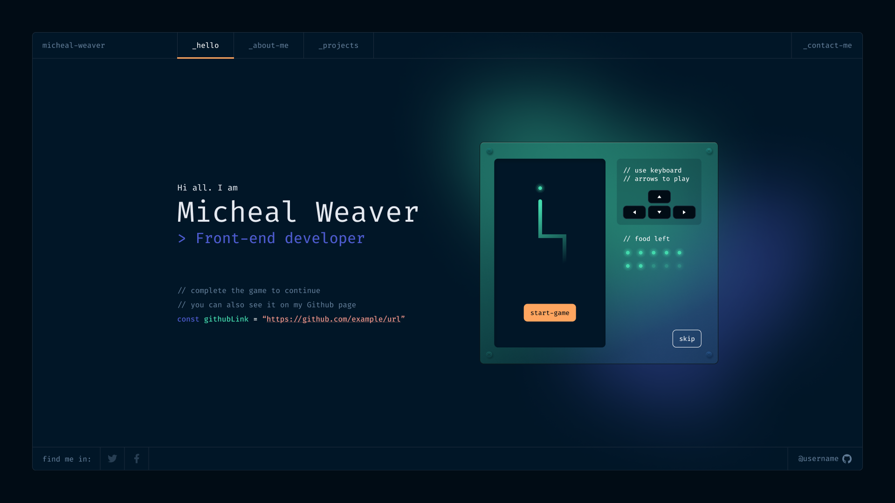

<h1 align="center">
  developer-portfolio-v2
</h1>
<p align="center">
  The first open source version of <a href="https://www.figma.com/community/file/1100794861710979147" target="_blank">Portfolio for Developers Concept V.2</a>, designed by <a href="https://www.behance.net/darelova" target="_blank">@darelova</a> and developed by <a href="https://github.com/alexdeploy">@alexdeploy</a>. Built with <a href="https://nuxt.com/" target="_blank">Nuxt 4</a>, <a href="https://tailwindcss.com/" target="_blank">Tailwind CSS 4</a> and TypeScript, hosted on <a href="https://www.netlify.com/" target="_blank">Netlify</a>.
</p>
<div align="center">

[](https://app.netlify.com/sites/developer-portfolio-v2/deploys)
[](https://github.com/alexdeploy/developer-portfolio-v2/actions/workflows/ci.yml)
[](./LICENSE)

</div>

<p align="center">
  <a href="https://developer-portfolio-v1.netlify.app/" target="_blank">
    
  </a>
</p>

## 📌 Versions

| Version | Branch | Stack | Status |
|---|---|---|---|
| **v2** (2.0.0-beta.1) | [`next`](https://github.com/alexdeploy/developer-portfolio-v2/tree/next) | Nuxt 4, TypeScript, Tailwind CSS 4, pnpm | Beta available, roadmap in [#39](https://github.com/alexdeploy/developer-portfolio-v2/issues/39) |
| **v1** (1.9.6) | [`v1`](https://github.com/alexdeploy/developer-portfolio-v2/tree/v1) | Nuxt 3, Tailwind CSS 3, yarn | Frozen; stays available |

The design and `developer.json`, the file with your content, are the same in both. v2 brings the
template to the current stack and fixes the known bugs: see the [CHANGELOG](./CHANGELOG.md), which
includes a short [upgrade guide](./CHANGELOG.md#upgrading-from-v1). If you forked v1, nothing
changes in your copy unless you decide to upgrade.

To try the beta: `git clone --branch v2.0.0-beta.1 https://github.com/alexdeploy/developer-portfolio-v2.git`,
then follow the installation steps below. Feedback is welcome in [#39](https://github.com/alexdeploy/developer-portfolio-v2/issues/39).

## ✨ What you get

- Your content in one JSON file, validated by a [JSON Schema](./developer.schema.json) with editor
  autocompletion. A mistake stops `pnpm dev` with the exact error instead of breaking a page.
- SEO and sharing ready: page titles, canonical links, Open Graph and Twitter cards and the web app
  manifest come from the same file.
- Accessible by default: keyboard operable, screen-reader friendly, no axe-core violations.
- Static site or server-rendered app, your choice at build time.
- Tests, type checking, linting and CI already set up, plus a Renovate config for dependency updates.

## 🚨 Forking this repo

Feel free to fork this repository and make it your own! You can use it as a starting point for your own portfolio website. However, please note that the effort and time deserves to be recognized and *plagiarism is a bad practice*. If you use this project, we would greatly appreciate it if you give credits to the designer <a href="https://www.behance.net/darelova" target="_blank">@darelova</a> and the developer <a href="https://github.com/alexdeploy">@alexdeploy</a>, or linking <a href="https://github.com/alexdeploy/developer-portfolio-v2">this repo</a>.

Thanks 🤘 and enjoy it!

## 🛠 Installation

Requirements: Node 22.22.3 or newer (24 recommended, it is the version in `.nvmrc`) and pnpm,
which ships with Node through Corepack.

1. Clone the project to your local machine.

```sh
git clone https://github.com/alexdeploy/developer-portfolio-v2.git
cd developer-portfolio-v2
```

2. Select the Node version and enable pnpm (once per machine).

```sh
nvm use            # or install Node 24 any other way
corepack enable
```

3. Install the dependencies.

```sh
pnpm install
```

4. Start the development server and open <a href="http://localhost:3000/">http://localhost:3000/</a>.

```sh
pnpm dev
```

## ✒️ Customization

The portfolio template includes some default content, but you can easily customize it to fit your needs. Here are some of the things you can change:

* Update the `developer.json` file on root directory, which contains all the text for the project and the portfolio "user" information, including *projects*, *about-me*, *gists* (Ids) and *contact* info.

  Its format is described in [`developer.schema.json`](./developer.schema.json). Editors such as VS Code use it to autocomplete and validate the file as you type, and `pnpm dev` / `pnpm build` stop with a clear error if the file does not match the schema.

* Fill in the optional `site` block of `developer.json` (public URL, description, sharing image, language). It drives the `<head>` meta tags, the social sharing cards and the web app manifest, which is generated at `/pwa/manifest.json`; nothing else needs editing for SEO.

* Replace the images under `public/` (project screenshots, sharing image, PWA icons) with yours.

* Update the `nuxt.config.ts` file for additional configuration.

* Change the styling and design of the website to match your personal style. Colours and fonts are `@theme` tokens in `app/assets/tailwind.css`.

## 🚀 Building and deploying

Static site (what the demo on Netlify uses): every page is prerendered into `.output/public`, ready for any static host.

```sh
pnpm generate
```

Server-rendered app: builds a Node server into `.output/`, started with `node .output/server/index.mjs`. `pnpm preview` runs it locally.

```sh
pnpm build
pnpm preview
```

## 🧰 Commands

| Command | What it does |
|---|---|
| `pnpm dev` | Development server with hot reload on http://localhost:3000 |
| `pnpm generate` | Static build into `.output/public` |
| `pnpm build` / `pnpm preview` | Server-rendered build and a local preview of it |
| `pnpm test` / `pnpm test:watch` | Vitest, once or in watch mode |
| `pnpm typecheck` | `vue-tsc` over the app and the tests |
| `pnpm lint` / `pnpm lint:fix` | ESLint (it is also the formatter) |
| `pnpm schema:types` | Regenerates the TypeScript types of `developer.json` from the schema |

CI runs lint, typecheck, tests, `build` and `generate` on every push and pull request.

## 🗂 Project structure

```
developer.json           Your content (validated against developer.schema.json)
app/                     Nuxt app: pages/, components/, assets/, utils/
shared/                  Code and types shared by the app, the server and nuxt.config.ts
server/routes/           The generated web app manifest
modules/                 Local Nuxt module that validates developer.json on start
public/                  Static files: images and icons
test/                    Vitest tests (plain Node at the top level, test/nuxt/ in a Nuxt environment)
```

## 🔄 Dependency updates

Dependencies are kept current by [Renovate](https://docs.renovatebot.com/), configured in [`renovate.json`](./renovate.json): it pins development dependencies, waits a few days before proposing a new npm release, and merges minor and patch updates of the tooling once CI passes. Forks are not affected unless you install the [Renovate GitHub App](https://github.com/apps/renovate) on your own repository; delete the file if you prefer another tool.

## Contributions

If you find any bugs or have any suggestions, you can open an <a href="https://github.com/alexdeploy/developer-portfolio-v2/issues">issue</a>. Pull requests for v2 go to the `next` branch until 2.0.0 is released.

## License

This project is licensed under the MIT License. See the <a href="https://github.com/alexdeploy/developer-portfolio-v2/blob/main/LICENSE">LICENSE</a> file for more information.
